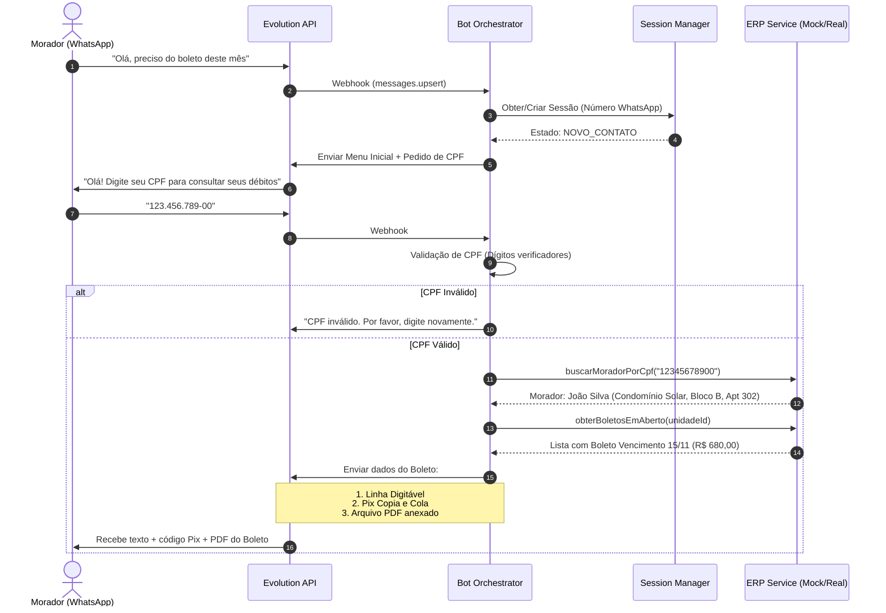

# 🏗️ Arquitetura do Sistema de Autoatendimento Condominial

## Diagrama de Fluxo

## Estrutura de Pastas

- `src/index.ts`: Ponto de entrada do servidor Express.
- `src/config.ts`: Variáveis de ambiente e configuração.
- `src/types/`: Interfaces TypeScript (Mensagens, Sessões, Boletos, Moradores).
- `src/utils/`: Validadores (CPF com verificação matemática, formatadores e gerador Pix).
- `src/services/evolution.service.ts`: Comunicação HTTP com a Evolution API.
- `src/services/erp.service.ts`: Contrato de interface para provedores de ERP.
- `src/services/mock-erp.service.ts`: Provedor simulado com dados fictícios para testes imediatos.
- `src/bot/session.manager.ts`: Controle de estado e memória da conversa por telefone.
- `src/bot/bot.orchestrator.ts`: Motor de tomada de decisão e respostas automáticas.
- `src/routes/webhook.routes.ts`: Rota para receber os eventos da Evolution API.
