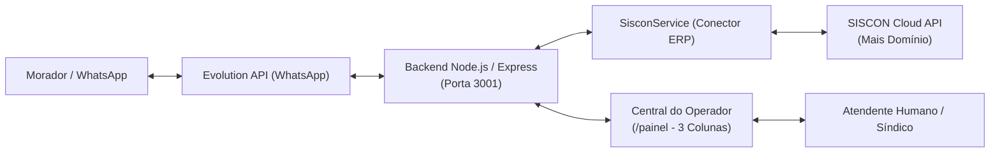

# Guia Técnico de Integração: SISCON ERP (Mais Domínio) & Central WhatsApp

Este documento detalha o funcionamento técnico da integração entre a plataforma de automação e atendimento WhatsApp (`chatbot-condominio`) e o ecossistema **SISCON Gestão Condominial**, desenvolvido pela **Mais Domínio Soluções**.

---

## 1. Visão Geral da Arquitetura

O sistema atua como a camada inteligente de atendimento 24/7 e cockpit operacional conectada diretamente ao banco de dados e APIs do **SISCON**.



---

## 2. Recursos e Capacidades Conectadas ao SISCON

| Recurso | Descrição Técnica | Módulo SISCON Correspondente |
| :--- | :--- | :--- |
| **Identificação do Morador** | Consulta instantânea por CPF ou telefone com vínculo de múltiplas unidades/blocos | *Siscon Gestão / Condôminos* |
| **2ª Via de Boletos** | Listagem de títulos abertos e emissão com recálculo automático de juros/multa em atraso | *Siscon Financeiro / Boleto Direto* |
| **Pix Copia e Cola** | Geração e entrega do código Pix dinâmico com baixa e conciliação bancária imediata | *Siscon Cobrança Pix* |
| **SISCON Medição** | Leitura e histórico de consumo individualizado de água e gás com fotos do hidrômetro | *Siscon Medição Mobile* |
| **Registro de Ocorrências** | Abertura de protocolos de manutenção/reclamações com fotos e gravação no CRM | *Siscon Atendimento & Ocorrências* |
| **Comunicados e Disparos** | Transmissão de avisos urgentes e circulares oficiais para grupos de condomínios | *Siscon Circulares / WhatsApp* |

---

## 3. Configuração de Variáveis de Ambiente (`.env`)

Para conectar o sistema ao ambiente de produção do SISCON, configure o arquivo `.env`:

```env
# Porta do Servidor
PORT=3001

# Provedor de ERP
ERP_PROVIDER=siscon

# Credenciais Oficiais SISCON (Mais Domínio)
SISCON_BASE_URL=https://api.siscongestao.com.br/v1
SISCON_API_TOKEN=seu_token_de_homologacao_ou_producao
SISCON_CLIENT_ID=seu_client_id_siscon
SISCON_CLIENT_SECRET=seu_client_secret_siscon
SISCON_EMPRESA_ID=1

# WhatsApp Gateway (Evolution API)
EVOLUTION_API_URL=http://localhost:8080
EVOLUTION_API_KEY=B6D711FCDE4D4FD5936544120E713976
EVOLUTION_INSTANCE_NAME=condominio_bot
```

> [!NOTE]
> **Modo Sandbox / Fallback Automático**: Se `SISCON_API_TOKEN` não for fornecido ou for a chave padrão, o conector `SisconService` ativa automaticamente o modo Sandbox/Simulação, provendo dados realistas para homologação sem interrupção dos serviços.

---

## 4. Endpoints da API REST Operacional (`/api`)

A Central do Operador e aplicações externas consom os seguintes endpoints:

### Painel e Sessões
- `GET /api/dashboard/stats`: Métricas em tempo real (total de conversas, taxa de automação, tempo de resposta, boletos emitidos, status da conexão SISCON).
- `GET /api/conversas`: Lista todas as conversas ativas no WhatsApp sincronizadas com o perfil do morador.
- `GET /api/conversas/:remoteJid`: Detalhes e histórico da conversa selecionada.
- `POST /api/conversas/:remoteJid/mensagem`: Envio de resposta manual do operador humano via WhatsApp.
- `POST /api/conversas/:remoteJid/enviar-boleto`: Disparo manual com 1 clique da 2ª via atualizada (Linha Digitável, Pix e link PDF).
- `POST /api/conversas/:remoteJid/transferir`: Transfere o controle entre o bot automatizado e o operador humano (Handoff).

### Consultas Diretas SISCON
- `GET /api/siscon/morador/:cpf`: Busca cadastro completo do condômino no SISCON e seus boletos pendentes por unidade.
- `GET /api/siscon/medicao/:unidadeId`: Consulta leituras de água e gás do módulo *SISCON Medição*.

### Disparos e Transmissão
- `POST /api/disparos/grupo`: Disparo de avisos ou comunicados urgentes para grupos de WhatsApp do condomínio.

---

## 5. Como Executar o Sistema

```bash
# 1. Instalar dependências (caso necessário)
npm install

# 2. Compilar TypeScript
npx tsc

# 3. Iniciar servidor operacional
npm run start
# ou
node dist/index.js
```

Acessos disponíveis:
- **Painel do Operador (Cockpit)**: `http://localhost:3001/painel`
- **Simulador Interativo do Morador**: `http://localhost:3001/docs/`
- **Webhook Evolution API**: `http://localhost:3001/webhook/evolution`
