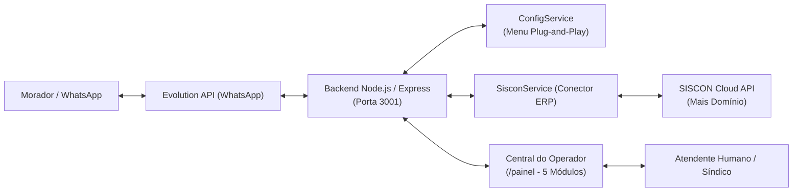

# Guia Técnico de Integração: SISCON ERP (Mais Domínio) & Central WhatsApp

Este documento detalha o funcionamento técnico da integração entre a plataforma de automação e atendimento WhatsApp (`chatbot-condominio`) e o ecossistema **SISCON Gestão Condominial**, desenvolvido pela **Mais Domínio Soluções** ([siscongestao.com.br](https://siscongestao.com.br)).

---

## 1. Visão Geral da Arquitetura

O sistema atua como a camada inteligente de atendimento 24/7, régua de cobrança automática, parcelamento de acordos e cockpit operacional conectada diretamente ao banco de dados e APIs do **SISCON**.



---

## 2. Recursos e Capacidades Conectadas ao SISCON

| Recurso | Descrição Técnica | Módulo SISCON Correspondente |
| :--- | :--- | :--- |
| **Identificação do Morador** | Consulta instantânea por CPF ou telefone com vínculo de múltiplas unidades/blocos | *Siscon Gestão / Condôminos* |
| **Boletos com Registro Bancário Direto** | Emissão sem remessa/retorno (Inter, Itaú, Santander, Sicoob, Sicredi, Cora) em até 30min com cash back | *Siscon Cobrança Bancária* |
| **2ª Via & Recálculo Automático** | Recálculo instantâneo de multa regimental (2%) e juros de mora (1% a.m.) proporcionais aos dias de atraso | *Siscon Financeiro / Boleto Direto* |
| **Pix Copia e Cola Dinâmico** | Geração e entrega do código Pix dinâmico com baixa e conciliação bancária imediata | *Siscon Cobrança Pix* |
| **Acordos & Parcelamentos de Dívidas** | Simulação em até 12x, confissão de dívida digital, cancelamento de boletos anteriores e emissão de parcelas | *Siscon Acordos e Inadimplência* |
| **Régua de Cobrança Automática** | Disparos preventivos (D-3), no vencimento (D-0), cobrança amigável (D+3) e convite para acordo (D+7) | *Siscon Régua de Cobrança* |
| **Reservas de Áreas Comuns** | Reserva de churrasqueira, salão de festas e quadras com lançamento automático da taxa no próximo boleto | *Siscon Áreas Comuns* |
| **SISCON Medição** | Leitura de água e gás por app nativo offline, com foto do hidrômetro e detecção de vazamentos | *Siscon Medição Mobile* |
| **Certidões & Nada Consta** | Emissão de Certidão Negativa de Débitos (Art. 1.336 CC) e Declaração Anual de Quitação (Lei 12.007/2009) | *Siscon Documentos Oficiais* |
| **Registro de Ocorrências** | Abertura de protocolos de manutenção/reclamações com fotos e gravação no CRM do condomínio | *Siscon Atendimento & Ocorrências* |
| **Comunicados e Disparos em Massa** | Transmissão de avisos urgentes e circulares oficiais para grupos de WhatsApp do condomínio | *Siscon Circulares / WhatsApp* |

---

## 3. Configuração Plug-and-Play no Menu do Sistema

Não é necessário alterar arquivos de código ou `.env` para plugar sua conta SISCON. Basta acessar a aba **⚙️ Configurações** no painel (`http://localhost:3001/painel`):

1. **Credenciais SISCON Cloud (Mais Domínio)**:
   - `SISCON Base URL`: Endpoint da API SISCON (padrão `https://api.siscongestao.com.br/v1`).
   - `SISCON API Token / Chave de Acesso`: Chave de autenticação gerada no painel SISCON Gestão.
   - `Client ID` & `Client Secret`: Chaves de aplicação OAuth2.
2. **Conexão Bancária Direta**:
   - Selecione a instituição financeira integrada no condomínio (Banco Inter, Itaú, Santander, Sicoob, Sicredi, Cora, Bradesco).
   - Ative o abatimento de até 35% de cash back de tarifa bancária na mensalidade SISCON.
3. **Parâmetros de Acordo & Inadimplência**:
   - Multa por atraso (% - padrão 2.0%).
   - Juros de mora mensal (% - padrão 1.0%).
   - Número máximo de parcelas permitidas (ex: 12x).
   - Valor mínimo de parcela (ex: R$ 100,00).
4. **Régua de Cobrança Automática**:
   - Defina dias prévios (ex: 3 dias antes) e dias pós-vencimento (3 e 7 dias).
5. **Botão ⚡ Testar Conexão Agora**:
   - Valida a conectividade com o servidor SISCON Cloud em tempo real, informando latência e módulos ativos.
6. **Botão 💾 Salvar Configurações**:
   - Persiste as alterações no arquivo `data/system-config.json` sem reiniciar a aplicação.

---

## 4. Endpoints da API REST Operacional (`/api`)

### Configurações & Conexão Plug-and-Play
- `GET /api/configuracoes`: Retorna status da conexão e chaves públicas mascaradas.
- `POST /api/configuracoes`: Salva novos parâmetros de integração e cobrança.
- `POST /api/configuracoes/testar-conexao`: Testa em tempo real a comunicação com a API SISCON.

### Cobrança, Régua & Acordos de Dívidas
- `GET /api/acordos/simular/:unidadeId`: Retorna simulação detalhada com multa, juros e opções de 1x a 12x.
- `POST /api/acordos/firmar`: Efetiva o acordo, cancela pendências anteriores e emite as parcelas com linha digitável e Pix.
- `POST /api/cobranca/disparar-regua`: Executa a régua de cobrança automática com base no calendário de vencimentos.

### Reservas de Áreas Comuns
- `GET /api/reservas/areas`: Lista os espaços comuns cadastrados no SISCON e valores de taxa.
- `GET /api/reservas/disponibilidade/:areaId?data=YYYY-MM-DD`: Verifica disponibilidade de data.
- `POST /api/reservas/solicitar`: Realiza a reserva e agenda a cobrança na próxima cota condominial.

### Certidões Oficiais & SISCON Medição
- `GET /api/certidoes/nada-consta/:unidadeId`: Emite a Certidão Negativa de Débitos (Art. 1.336 CC).
- `GET /api/certidoes/quitacao-anual/:unidadeId`: Emite a Declaração de Quitação Anual (Lei 12.007/2009).
- `GET /api/siscon/medicao/:unidadeId`: Consulta consumo de água e gás com foto do hidrômetro.

### Gestão de Atendimento & WhatsApp
- `GET /api/dashboard/stats`: Métricas em tempo real do sistema.
- `GET /api/conversas`: Lista conversas sincronizadas.
- `POST /api/conversas/:remoteJid/mensagem`: Mensagem manual do atendente.
- `POST /api/conversas/:remoteJid/enviar-boleto`: Disparo manual da 2ª via com 1 clique.
- `POST /api/conversas/:remoteJid/transferir`: Handoff entre robô e operador humano.
- `POST /api/disparos/grupo`: Disparo de comunicados em massa para grupos de WhatsApp.

---

## 5. Como Executar o Sistema

```bash
# 1. Compilar TypeScript
npx tsc

# 2. Iniciar servidor operacional
npm run start
# ou
node dist/index.js
```

Acessos:
- **Painel Central (Cockpit & Menu de Configurações)**: `http://localhost:3001/painel`
- **Simulador Interativo do Condômino**: `http://localhost:3001/docs/`
- **Webhook Evolution API**: `http://localhost:3001/webhook/evolution`
